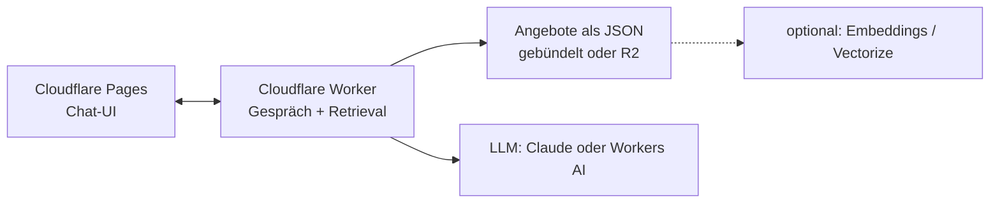

# Lernlotse

Ein Gesprächs-Agent, der Familien in Heilbronn zu einem passenden Lernangebot lotst — nicht zu einem Katalog, sondern zu einem konkreten Angebot mit Link und kurzer Begründung.

Projekt für die aim-Challenge **Build a Learning Guide** beim Future City Hackathon 2026 (HHN TechCampus Heilbronn). Solo.

## Problem

Lernangebote in Heilbronn liegen verteilt bei mehreren Trägern. Familien müssen mehrere Kalender durchsuchen und wissen oft nicht, was zum Alter, zum Interesse und zur verfügbaren Zeit passt. Was junge Menschen suchen und was fehlt, wird kaum sichtbar.

## Lösung

Lernlotse führt ein kurzes Gespräch (Alter, Interesse, Format), sucht in einem kuratierten Bestand **echter** Angebote und empfiehlt ein passendes Angebot inkl. Link und einem Satz zum Warum (Nachvollziehbarkeit, Human-Agent-Interface).

Fokus-Träger: aim, experimenta, Haus der Familie, IPAI Foundation.
Fokus-Themen: AI, Coding, Gaming.

Zusätzlich eine Lücken-Ansicht: anonymisierte Nachfrage aus Gesprächs-Absichten im Vergleich zum vorhandenen Angebot — ohne Speicherung personenbezogener Daten.

Ideen und Designhaltung stammen aus [smlfg/agent](https://github.com/smlfg/agent) (Vision- und Design-Repo, keine lauffähige App). Der Agent führt zu den Angeboten der Träger, nicht zu persönlichen Inhalten des Autors.

## Demo-Flow

1. Begrüßung: Hilfe beim Finden eines Lernangebots in Heilbronn.
2. Alter: eigenes Alter oder Alter des Kindes.
3. Interesse: Coding, Gaming, KI oder ein nahes Thema.
4. Format: einmaliger Workshop oder regelmäßiger Kurs, grobe Verfügbarkeit.
5. Empfehlung: ein konkretes Angebot, Link zur Anmeldung, ein Satz warum es passt.
6. Optional: Alternativvorschlag oder ehrlicher Hinweis, wenn nichts passt (fließt in die Lücken-Ansicht).

## Architektur



In den ersten Stunden läuft alles lokal (`wrangler dev` oder ein lokaler Dev-Server). Ein Cloudflare-Deploy ist das Ziel, nicht die Voraussetzung für die Demo.

## Technik und warum

| Wahl | Warum | Fallback |
|---|---|---|
| Cloudflare Workers + Pages | Bekannter Stack, ein Deploy, wenig Betrieb | Lokal mit wrangler oder statischem HTML |
| Kuratiertes JSON statt Live-Scraping | Zuverlässigkeit auf der Bühne | — |
| Filter zuerst, Embeddings optional | In etwa 12 Arbeitsstunden tragfähig | Keyword- und Feldfilter reichen |
| Claude oder Workers AI | Gesprächsführung; Workers AI ohne extra Key möglich | Feste Satzbausteine plus Retrieval |
| Keine Chat-Persistenz | Minderjährige / DSGVO | Nur anonyme Zähler für die Lücken-Ansicht |

## Daten und Datenschutz

Echte Angebote kommen nur aus öffentlich zugänglichen Angaben der Träger nach `data/offers.json`. Keine erfundenen Termine oder Links.

Der Chat speichert keine Verläufe, keine Namen, keine Kontaktdaten. Die Lücken-Ansicht nutzt höchstens anonyme Zähler (z. B. „Interesse Coding, Alter 8–12, kein Treffer“). Details: [docs/DATENSCHUTZ.md](docs/DATENSCHUTZ.md).

## Starten

Dieses Repo ist gerade ein Gerüst. Sobald Daten, Worker und UI stehen:

```bash
python3 scripts/validate-offers.py

cd worker && npx wrangler dev
cd web && npm run dev
```

Die konkreten Befehle hier nachziehen, sobald der jeweilige Teil wirklich existiert. Geheimnisse gehören in `.dev.vars` oder `.env` (nicht committen). Vorlage: `.env.example`.

## Status

- [x] Repo-Gerüst, Plan, Schema (Sa 14.11.2026, ca. 13:35 Europe/Berlin)
- [ ] Pitch-Slot bei aim (Sa 14:00)
- [ ] Mindestens 20 echte Angebote in `data/offers.json` (Sa 16:00)
- [ ] Filter/Retrieval: Testfrage liefert ein Angebot (Sa 18:00)
- [ ] Worker: ein kompletter Demo-Dialog lokal (Sa 20:00)
- [ ] Chat-UI im Browser, dann schlafen (Sa 22:00)
- [ ] 2–3 Demo-Szenarien, Lücken-Ansicht skizziert (So 08:00)
- [ ] Provider-Treffen ab 10:00, Demo steht (So 10:00)
- [ ] Pitch und README fertig (So 11:00, hart)
- [ ] Live-Test, Code auf `main` (So 12:30)
- [ ] Abgabe Präsentation + Code, Hacken stoppt (So 13:00)

Der verbindliche Zeitplan mit Wegpunkten, Checkpoints und Fallbacks steht in [PLAN.md](PLAN.md).
