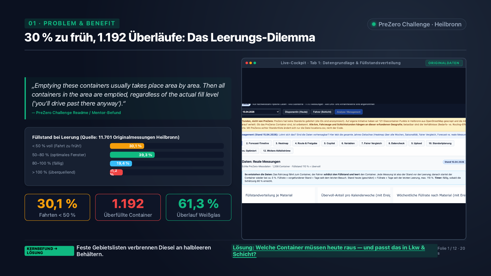
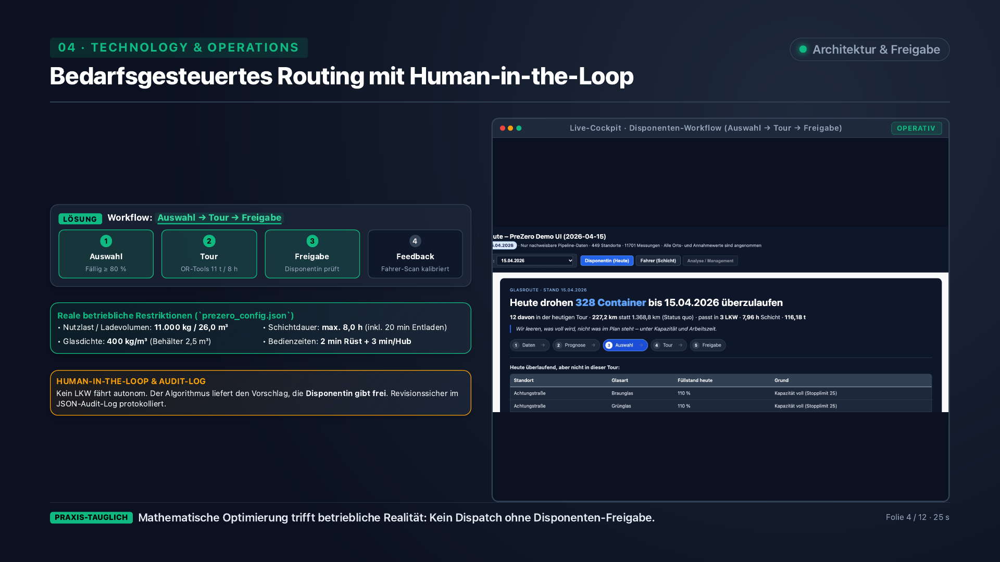
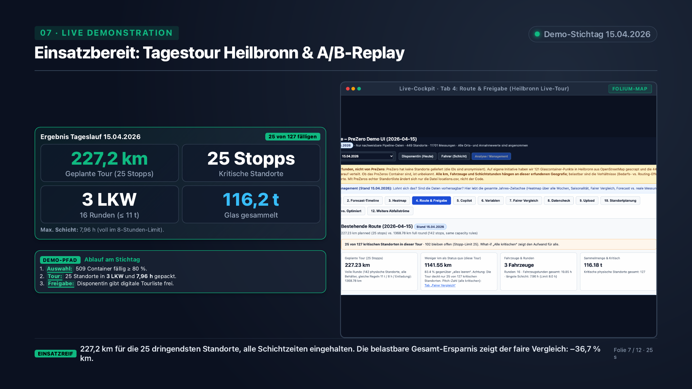
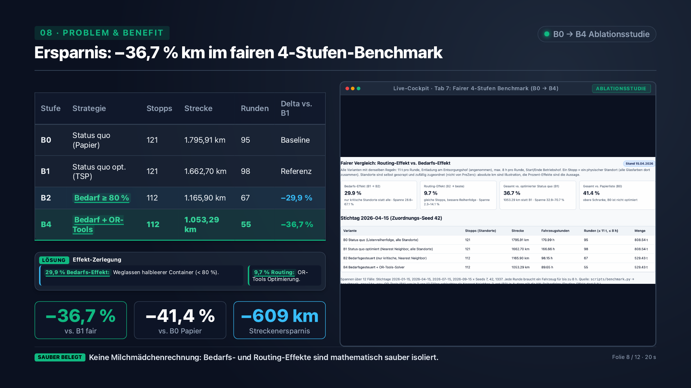

# GlasRoute

Priorisierung und Tourenplanung für Glascontainer in Heilbronn. Prototyp für die PreZero-Challenge beim Future City Hackathon 2026 der Hochschule Heilbronn (HHN).

## Status

Hackathon-Prototyp. Es gibt keine öffentlich erreichbare Demo-URL; die Oberfläche wird lokal als HTML erzeugt. Das Pitch-Deck liegt im Repository: [Pitch/pitch_deck.pdf](Pitch/pitch_deck.pdf), interaktiv als [Pitch/slides.html](Pitch/slides.html).

## Problem

PreZero leert Glascontainer in Heilbronn nach festen Gebietslisten. Fahrzeuge fahren dadurch auch halb leere Behälter an, während andere überlaufen. Die Füllstände stammen nicht von Sensoren, sondern von Fahrerschätzungen in 10-Prozent-Schritten.

Aus 11.701 Originalmessungen (449 Container) ergibt die vorhandene Auswertung: 30,1 % der Leerungen lagen unter 50 % Füllstand, 1.192 Messungen gelten als überfüllt.



## Lösung

Die Pipeline übersetzt die Messreihen in einen Tagesvorschlag, der erst nach Disponenten-Freigabe gilt:

1. **Daten** — Roh-CSV einlesen und bereinigen (`data/raw/glass_fill_levels_anonymized_f.csv`).
2. **Auswahl** — Container nach Füllrate, Überlaufhäufigkeit und Saisonalität bewerten; am Demo-Tag werden die 25 dringendsten Standorte gesetzt (`--max-stops 25`).
3. **Tour** — Eine kapazitäts- und schichtbeschränkte Route wird gebaut (im CLI-Befehl `run` per Nearest-Neighbor; der faire Benchmark-Schritt B4 nutzt optional OR-Tools).
4. **Freigabe** — `prezero-route propose` und `prezero-route approve` protokollieren die Entscheidung. Ohne Freigabe wird nichts dispatcht.



## Demo-Lauf (15.04.2026)

Lokal ausgeführt mit `prezero-route run --date 2026-04-15`. Die Kennzahlen entsprechen [Pitch/demo_facts.txt](Pitch/demo_facts.txt):

| | |
|---|---|
| Kritische physische Standorte (Container) | 127 (509) |
| Davon geschätzt ≥ 110 % voll | 488 |
| Stopps in der Tour | 25 |
| Geplante Tour | 227,23 km |
| Volle Runde, gleiche Regeln, alle 142 Standorte | 1.368,78 km |
| Fairer Benchmark B1 → B4 (gleiche Regeln, 4 Stichtage × 3 Seeds: 32,9–70,7 %) | −36,7 % km (1.662,70 → 1.053,29 km) |
| Fahrzeuge / Runden | 3 / 16 |
| Fahrzeugstunden / längste Schicht | 19,85 h / 7,96 h (Limit 8,0 h) |
| Gesammelte Menge | 116,18 t |

Die 83,4 % Ersparnis der 25-Stopp-Teiltour gegenüber „alle 142 Standorte leeren“ ist in der Oberfläche sichtbar, aber keine Pitch-Kennzahl. Absolute Kilometer und Stunden hängen von Annahmen in `prezero_config.json` ab; belastbar sind die Verhältnisse.





Die Folien sind Seiten 1, 4, 7 und 8 aus [Pitch/pitch_deck.pdf](Pitch/pitch_deck.pdf) (Stand 15.11.2026, 11:07 Europe/Berlin). Weitere UI-Ausschnitte liegen unter [Pitch/screenshots/](Pitch/screenshots/).

## Was echt ist und was simuliert wird

- **Echt:** 11.701 Füllstandsmessungen von PreZero. Die IDs sind anonymisiert.
- **Simuliert:** Die Zuordnung anonymisierter IDs zu Koordinaten. Die Punkte selbst sind echte OpenStreetMap-Glascontainer-Standorte in Heilbronn, die ID-Zuweisung ist deterministisch simuliert (`seed = 2026`, `source = osm_assigned`, `confidence = simulated_mapping`). Echte Koordinaten lassen sich über `data/external/locations_real.csv` und `scripts/refresh_locations.py --real` einsetzen, ohne den restlichen Code zu ändern.
- **Geschätzt:** Der „Stand heute“ ergibt sich aus Füllrate mal Tagen seit der letzten Leerung, nicht aus einer aktuellen Messung.
- **Distanzen:** Haversine mit Umwegfaktor 1,35, kein Straßenrouting.
- Weitere Abfallströme (Papier, Bio, Gastro, Plastik) sind ein Teaser auf synthetischen Daten: [Pitch/streams_teaser.html](Pitch/streams_teaser.html).

## Funktionen

- CLI-Pipeline: Ingest, Scoring, Routenbau, Karte, Heatmap und lokale Website
- Disponenten-Freigabe mit schriftlichem Beleg
- Prognose +0/+7/+14/+21 Tage
- Copilot (`prezero-route copilot`) für Überblick, Erklärung und erlaubte What-if-Fragen
- Backtest und fairer Vergleich B0–B4 (`scripts/backtest.py`, `scripts/benchmark.py`)
- Offline nutzbare HTML-Oberfläche; Kartenkacheln kommen von OpenStreetMap und bleiben ohne Netz leer

## Technik

- Python 3.10+ (Paket `prezero-route`, Einstiegspunkte `prezero` und `prezero-route`)
- pandas, NumPy, scikit-learn, OR-Tools (Benchmark B4), Folium, Matplotlib, Plotly, Click
- Betriebsparameter in `prezero_config.json`

## Schnellstart

Voraussetzung: Python 3.10 oder neuer.

```bash
python3 -m venv .venv
source .venv/bin/activate
pip install -e ".[test]"
pip install pyyaml
prezero-route run --date 2026-04-15
prezero-route serve --port 8000
```

`run` schreibt unter anderem `route_2026-04-15.json`, `map_2026-04-15.html`, `trends.png`, `heatmap.html` und `ui_2026-04-15.html`. `serve` liefert dieses Verzeichnis unter http://127.0.0.1:8000/ aus (Ctrl+C beendet den Server); die Website ist die Datei `ui_2026-04-15.html`.

`PyYAML` wird von `src/prezero/routing.py` importiert, steht aber derzeit nicht in `pyproject.toml`. Ohne `pip install pyyaml` startet die CLI nicht.

## Verwendung

| Befehl | Zweck |
|---|---|
| `prezero-route ingest` | Rohdaten einlesen und bereinigen |
| `prezero-route score --date YYYY-MM-DD` | Merkmale und Kritikalität bis zum Stichtag |
| `prezero-route route --date YYYY-MM-DD` | Route als `route_<datum>.json` |
| `prezero-route run --date 2026-04-15` | Gesamte Pipeline inklusive Website |
| `prezero-route ui --date 2026-04-15` | Nur die Datei `ui_<datum>.html` bauen |
| `prezero-route serve --port 8000` | Das Ausgabe-Verzeichnis per HTTP ausliefern |
| `prezero-route propose` | Route in einen Freigabe-Vorschlag verwandeln |
| `prezero-route approve --by "Disponentin"` | Vorschlag annehmen oder mit `--reject` ablehnen |
| `prezero-route forecast --date YYYY-MM-DD` | Prognose +0/+7/+14/+21 und Prognosekarte |
| `prezero-route heatmap --date YYYY-MM-DD` | Offline-Heatmap der Container |
| `prezero-route visualize --date YYYY-MM-DD` | `trends.png` und `map_<datum>.html` |
| `prezero-route copilot overview` | Verbindlichen Tour-Überblick anzeigen |

`--stream` wählt `glass` (Standard), `paper`, `bio`, `gastro` oder `plastik`. Hilfe zu jedem Unterbefehl: `prezero-route <befehl> --help`.

## Konfiguration

Betriebliche Annahmen stehen in `prezero_config.json`, unter anderem Fahrzeughöchstlast (11 t), Volumen (26 m³), Behältervolumen (2,5 m³), Glasdichte (400 kg/m³), Schichtlänge (8 h) und Umwegfaktor (1,35). Die Datei kann mit `--config` übergeben werden.

## Entwicklung und Tests

```bash
pip install -e ".[test]"
pip install pyyaml
pytest tests/ -q
```

`pytest tests/` braucht das optionale Extra `test` (pytest, beautifulsoup4) sowie PyYAML. In dieser Umgebung am 15.11.2026: 153 bestanden, 1 fehlgeschlagen, 1 übersprungen (155 s). Der Fehler liegt in `tests/test_copilot.py::test_copilot_all_ten_intents_return_structured_output_with_stand_and_sources` (`sources` war leer). [docs/STATUS.md](docs/STATUS.md) vermerkt am 15.11.2026, 09:52 Europe/Berlin noch 154 von 154 Tests grün.

## Grenzen

- Koordinaten nutzen die simulierte ID-zu-OSM-Zuordnung; der Tauschpfad für echte PreZero-Koordinaten ist vorbereitet.
- Distanzen sind Luftlinie mit Umwegfaktor, kein Straßenrouting.
- Betriebsgrößen in `prezero_config.json` sind Annahmen.
- Noch keine mehrtägige Flottenoptimierung.
- Der CLI-Befehl `route` / `run` plant mit Nearest-Neighbor; OR-Tools erscheint im fairen Benchmark (B4), nicht als Standard-Solver der Tagesroute.

## Hackathon

Entstanden zur PreZero-Challenge beim Future City Hackathon 2026 der Hochschule Heilbronn. Im Git-Log ist als Autor nur Samuel Fleig (smlfg) eingetragen.

## Lizenz

Noch keine LICENSE-Datei; damit gelten zunächst alle Rechte vorbehalten.
