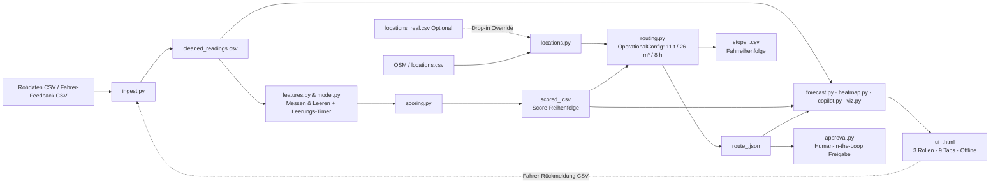

# Architektur — GlasRoute (PreZero Route)

Dieses Dokument beschreibt den aktuellen Stand der Pipeline, des Domänenmodells, der Benutzeroberfläche (`ui_<date>.html`), der konfigurierbaren Parameter (`OperationalConfig`) und der Validierungs-Skripte.

## 1. Gesamtdatenfluss

## 2. Domänenmodell: „Messen & Leeren“ und Leerungs-Timer

Das System bildet den realen Prozess ab (`src/prezero/features.py`, `src/prezero/model.py`, `src/prezero/scoring.py`):

1. **Messen vor dem Leeren:** Jede Zeile in `data/raw/glass_fill_levels_anonymized_f.csv` protokolliert den Füllstand, den der Fahrer **unmittelbar vor der Leerung** vorgefunden hat (`last_fill_level`, `110` für `overfull`). Unmittelbar nach dem Besuch startet der Behälter bei ca. `0 %`.
2. **Füllrate pro Tag (`avg_daily_increase`):** Aus aufeinanderfolgenden Messungen derselben `(Location_id, material_type)`-Serie wird die tägliche Nachfüllrate als `vorgefundener Stand / Tage seit letztem Besuch` berechnet (begrenzt auf `[0,5; 10,0]` Prozentpunkte/Tag; bei nur einer Messung dient der Material-Median als Fallback).
3. **Geschätzter Füllstand heute (`est_fill_level`):** Für den Stichtag `--date` wächst der Behälter seit dem letzten Besuch (`days_since_last_reading`) linear ab `0 %`: `est_fill_level = min(110, avg_daily_increase * days_since_last_reading)`.
4. **Leerungs-Timer & Kritikalität (`model.py`, `scoring.py`):**
   - `due_date`: prognostiziertes Datum für das Erreichen der `80 %`-Schwelle.
   - `overflow_date`: prognostiziertes Datum für das Erreichen von `110 %` (`overfull`).
   - `days_until_due`: verbleibende Tage bis zur Fälligkeit; der Dringlichkeits-`score` wächst monoton mit sinkendem `days_until_due`.
   - `critical`: wahr ab geschätztem Füllstand $\ge 80\text{ \%}$.

## 3. Module im Paket `src/prezero/`

| Modul | Verantwortung | Wichtigste Outputs |
|---|---|---|
| `ingest.py` | CSV laden, `fill_level_perc` bereinigen, `overfull` = 110 kodieren, Fahrer-Feedback zusammenführen | `data/processed/cleaned_readings.csv` |
| `locations.py` | Standortauflösung (`locations_real.csv` hat Vorrang vor `locations.csv`), Quelle & Konfidenz (`high`, `simulated_mapping`, `low`, `synthetic`) | kanonische Koordinaten je `Location_id` |
| `features.py` | Messen-und-Leeren-Zustand je `(Location_id, material_type)`, Füllrate, geschätzter Füllstand | Feature-DataFrame |
| `model.py` | Einheitliches Zustandsobjekt je Container inkl. Leerungs-Timer (`due_date`, `overflow_date`, `days_until_due`) | Modell-DataFrame |
| `scoring.py` | Timer-basiertes Kritikalitäts-Ranking (`score`, `critical`) | `data/processed/scored_<date>.csv` |
| `routing.py` | Aggregation auf physische Standorte (gerundete `lat/lon`), Nearest-Neighbor-Tour mit Gewichts- (11 t), Volumen- (26 m³), Schichtzeit- (8 h) und Entladestopps am Entsorgungshof (`disposal_depot`) | `route_<date>.json` & `stops_<date>.csv` (in **Fahrreihenfolge**) |
| `tour.py` | Vollständige Fahrzeug-Tourenansicht je Fahrzeug inkl. Start/Ende Betriebshof und Entladereihen | Touren-CSV & druckbare HTML-Tabelle |
| `forecast.py` | 4-Wochen-Prognose (+0 / +7 / +14 / +21 Tage) pro KW nach dem Messen-&-Leeren-Modell | KW-Status (`green`, `yellow`, `red`, `black`) |
| `heatmap.py` | Matrix über alle 1.338 Container und 51 Kalenderwochen (reale Messung vs. Wiederanstieg) | `heatmap.html` |
| `copilot.py` | Deterministischer Offline-Disponenten-Assistent: Touren-Überblick, 4 What-if-Simulationen, Container-Detailerklärungen, vorberechnete Q&A | JSON-Payload in `ui_<date>.html` & CLI `copilot` |
| `approval.py` | Human-in-the-Loop-Freigabe-Gate (`propose` / `approve` / `reject`) | `proposal.json`, `approval_<date>.json` |
| `viz.py` | Interaktive Folium-Routenkarte (`map_<date>.html`), Forecast-Karte, Heatmap-Wrapper und `trends.png` | HTML-Karten & PNG |
| `ui.py` | Generator der vollständigen Offline-Weboberfläche mit 3 Rollen-Ansichten und 9 Analyse-Tabs | `ui_<date>.html` |
| `cli.py` | Click-CLI (`ingest`, `score`, `route`, `forecast`, `heatmap`, `visualize`, `run`, `propose`, `approve`, `ui`, `serve`, `copilot`) | komplette Pipeline |

## 4. Benutzeroberfläche (`ui_<date>.html`)

Die Weboberfläche ist eine eigenständige HTML-Datei ohne Backend-Abhängigkeit (offline lauffähig):

### 4.1 Rollen-Einstieg (Startbildschirm)
1. **Fahrer (`#role-driver`):**
   - Zeigt nur explizit von der Disponentin freigegebene Touren (`localStorage`-Freigabe-Gate).
   - **Stoppliste in Fahrreihenfolge** (nicht Dringlichkeits-Reihenfolge), Google-Maps-Routenlink, Export der Stoppliste als CSV (`stoppliste_fahrreihenfolge_<date>.csv`), saubere **Druckansicht / PDF**, Checkbox `geleert`, Eingabe vorgefundener Füllstand in 10er-Schritten und Rückmeldungs-Export (`tour_feedback_<date>.csv`).
2. **Disponentin (`#role-dispatcher`):**
   - Tourenprüfung, explizite Freigabe mit Namenseintrag (`approval_<date>.json`), Rückführung einer ausgefüllten Fahrer-Feedback-CSV über `prezero-route run --input <feedback.csv>`.
3. **Analyse (`9 Tabs`):**

| Tab | ID | Inhalt & Besonderheiten |
|---|---|---|
| `1. Daten` | `#view-data` | Füllstandverteilung je Glasfarbe; Wochenverlauf (`Übervoll-Anteil` & `Wöchentliche Füllrate`) mit **Ereignis-Markierungen** (Weihnachten & Messpause, Nachweihnachtsspitze, Oster-, Pfingst-, Sommerferien BW, Heilbronner Weindorf); **Container-Gruppierung „Gleiches Verhalten“ (Combine)** nach Füllrate und Übervoll-Quote (*Hochlast*, *Mittellast*, *Niedriglast*, *Selten gemessen*); Messintervalle; Top-20 Übervoll (mit Copilot-Klick); historischer Forecast-Backtest (+7 / +14 Tage). |
| `2. Forecast-Timeline` | `#view-forecast` | Folium-Karte +0 / +7 / +14 / +21 Tage mit KW-Karten (`Rot >80%`, `Schwarz ≥110%`). |
| `3. Heatmap` | `#view-heatmap` | Container × Kalenderwoche-Matrix mit Wochen-Slider; Klick auf eine Zelle springt in `#view-route` und fokussiert den Container auf der Karte. |
| `4. Route & Freigabe` | `#view-route` | KPIs (Tour vs. volle Runde nach gleichen Regeln), Freigabe-Box, 4 vorberechnete What-if-Szenarien, interaktive Folium-Karte und **Stoppliste für den Fahrer in Fahrreihenfolge** inkl. CSV-Download und separater Druckansicht. |
| `5. Copilot` | `#view-copilot` | Deterministischer Touren-Überblick, What-if-Szenarien, 5 vorberechnete Disponenten-Fragen + Container-Detailerklärung (offline ohne LLM-Halluzination). |
| `6. Variablen` | `#view-variables` | Alle konfigurierbaren Parameter aus `OperationalConfig` (`prezero_config.json`) sowie automatischer Flotteneinsatz (Fahrzeuge & Runden bei Gewichts-, Volumen- oder Schichtüberschreitung). |
| `7. Fairer Vergleich` | `#view-benchmark` | Ergebnisse aus `scripts/benchmark.py` (B0 Papierliste vs. B1 Status quo NN vs. B2 Bedarfsgesteuert NN vs. B3 2-opt vs. B4 OR-Tools) über 4 Stichtage × 3 Zuordnungs-Seeds, getrennt nach **Bedarfs-Effekt** und **Routing-Effekt**. |
| `8. Datencheck` | `#view-datacheck` | Regularity Score (Mittel/Median), Stufensprünge > 50 pp, Messlücken > 90 Tage, Monatstrend (`trends.png`), Top-30-Ausreißer-Serien. |
| `9. Upload` | `#view-upload` | Lokale Browser-Prüfung beliebiger Mess- oder Feedback-CSVs per Drag & Drop (Containerzahl, Zeitraum, fehlende Werte, Overfull-Anzahl). |

## 5. Konfigurierbare Variablen (`OperationalConfig`)

Alle betrieblichen Annahmen liegen gebündelt in `OperationalConfig` (`src/prezero/routing.py`) und lassen sich ohne Codeänderung per JSON/YAML über `--config prezero_config.json` überschreiben:

| Variable | Standardwert | Wirkung im Routing |
|---|---|---|
| `density_kg_per_m3` | `400.0` | Standard-Schüttdichte für alle Abfallströme |
| `density_white_kg_per_m3` | `None` (Fallback `400.0`) | Optionale Glasdichte für Weißglas |
| `density_green_kg_per_m3` | `None` (Fallback `400.0`) | Optionale Glasdichte für Grünglas |
| `density_brown_kg_per_m3` | `None` (Fallback `400.0`) | Optionale Glasdichte für Braunglas |
| `container_volume_m3` | `2.5` | Behältervolumen zur Berechnung von Masse (`m³ × Stand × Dichte`) und Volumen |
| `vehicle_max_weight_kg` | `11000.0` | Zuladungsgrenze; Überschreitung erzwingt Zwischenentladung |
| `vehicle_max_volume_m3` | `26.0` | Ladevolumen-Grenze; Überschreitung erzwingt Zwischenentladung |
| `avg_speed_kmh` | `25.0` | Durchschnittsgeschwindigkeit für Fahrzeiten |
| `road_detour_factor` | `1.35` | Umwegfaktor auf Haversine-Luftlinie |
| `yard_depot` | `(49.1427, 9.2109)` | Start- und Endpunkt jeder Fahrzeugschicht (Betriebshof) |
| `disposal_depot` | `(49.1780, 9.2085)` | Entsorgungs-/Wertstoffhof für Entladestopps |
| `unload_time_min` | `20.0` | Entladezeit pro Zwischenentladung |
| `max_shift_hours` | `8.0` | Maximale Schichtdauer pro Fahrzeug; danach übernimmt das nächste Fahrzeug |
| `stop_setup_min` | `2.0` | Rangier-/Rüstzeit pro physischem Halt |
| `lift_time_per_bin_min` | `3.0` | Kran-/Hubzeit pro kritischem Einzelbehälter am Standort |

## 6. Reproduzierbarer Benchmark & Walk-Forward-Backtest

- **Fairer Benchmark (`scripts/benchmark.py` → `benchmark_results.csv`, `docs/BENCHMARK.md`, `benchmark.png`):**
  Vergleicht B0 (Papierliste), B1 (Alle Standorte NN), B2 (Bedarfsgesteuert NN), B3 (2-opt) und B4 (OR-Tools CVRP) unter identischen Gewichts-, Volumen-, Entlade- und Schichtregeln auf physischen Standorten. Der OR-Tools-Solver bricht deterministisch nach einer festen Lösungsanzahl (`SOLVER_SOLUTION_LIMIT = 25`) statt nach Wanduhrzeit ab, wodurch der **Routing-Effekt (B2 → B4: 9,7 % am 2026-04-15, Seed 42)** exakt reproduzierbar bleibt (neben **29,9 % Bedarfs-Effekt B1 → B2** und **41,4 % Gesamtersparnis B0 → B4**).
- **Walk-Forward-Backtest (`scripts/backtest.py` → `docs/BACKTEST.md`):**
  Prüft das Messen-&-Leeren-Modell zeitlich sauber out-of-sample über die realen Messreihen.

## 7. Austausch auf echte PreZero-Koordinaten (ohne Codeänderung)

1. Echte Koordinaten als `data/external/locations_real.csv` ablegen (`Location_id,lat,lon`, optional `source,confidence,match_reason`).
2. Pipeline ausführen (`prezero-route run --date 2026-04-15`) bzw. `python scripts/refresh_locations.py --real data/external/locations_real.csv`.
3. `prezero.locations` übernimmt alle realen Koordinaten automatisch vorrangig vor den simulierten/heuristischen OSM-Standorten (Details in `docs/archiv/GEO_DATENQUELLEN.md`, Zahlen dort veraltet).
