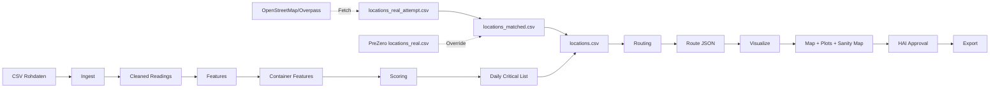

# Architektur

## Module

- `prezero.ingest` – CSV laden, bereinigen, `overfull` kodieren.
- `prezero.locations` – quellenunabhängige Standortauflösung (`load_locations`, `resolve_locations`), Material-Heuristik, reproduzierbarer Fallback (Seed 2026), Validierung und Sanity-Karte.
- `prezero.features` – Füllrate, Saison, Material-Cluster, Overfull-Häufigkeit.
- `prezero.scoring` – Kritikalitäts-Score pro Container/Zeitpunkt.
- `prezero.routing` – Tagesliste + Distanz-Heuristik.
- `prezero.viz` – Folium-Karte + Matplotlib-Trends.
- `prezero.cli` – Click-CLI.

## Geo-Positions-Pipeline

1. `scripts/fetch_locations.py` fragt offene Glascontainer-Kandidaten ab (Overpass, stdlib HTTP, 10 s Connect/30 s Read, 1 Retry, `OVERPASS_URL` optional) und schreibt `data/external/locations_real_attempt.csv`.
2. Aus `material_type` pro `Location_id` wird ein materialbewusstes, eindeutiges und deterministisches Matching erzeugt. Ohne PreZero-Schlüssel sind OSM-Zuordnungen **nur Heuristiken** (`confidence=low`, `match_reason` mit „UNVERIFIED“).
3. Fehlende IDs werden deterministisch in der Heilbronn-BBox synthetisiert (`source=synthetic_placeholder`, `confidence=synthetic`).
4. `scripts/refresh_locations.py` schreibt `locations_matched.csv`, das kanonische `locations.csv` (449 IDs) und `location_sanity_check.html` (Farbe nach Quelle).
5. Direkte Providerdaten (`prezero_supplied`, `high`) haben Vorrang vor Heuristiken/Synthetik.

Detaillierte Quellen und Grenzen: `docs/GEO_DATENQUELLEN.md`.

## PreZero-Koordinaten austauschen (ohne Codeänderung)

1. Echte Koordinaten als `data/external/locations_real.csv` ablegen (mindestens `Location_id,lat,lon`; optional `source,confidence,match_reason`).
2. `python scripts/refresh_locations.py --real data/external/locations_real.csv` ausführen.
3. Die Pipeline nutzt automatisch `locations_real.csv`/die erzeugte `locations.csv`; partielle Dateien überschreiben nur enthaltene IDs, alle anderen bleiben nachvollziehbar markiert.

## Technologiewahl

- Python + pandas: schnell, bekannt, reproduzierbar.
- Click: robustes CLI.
- requests/stdlib + Overpass JSON: einfacher, austauschbarer Fetch ohne schwere GIS-Abhängigkeiten.
- Folium/Matplotlib: statische Visualisierungen ohne Frontend-Overhead (Sanity-Map mit stdlib-Leaflet-Fallback).
- Haversine: Distanzen ohne externe Routing-API.
