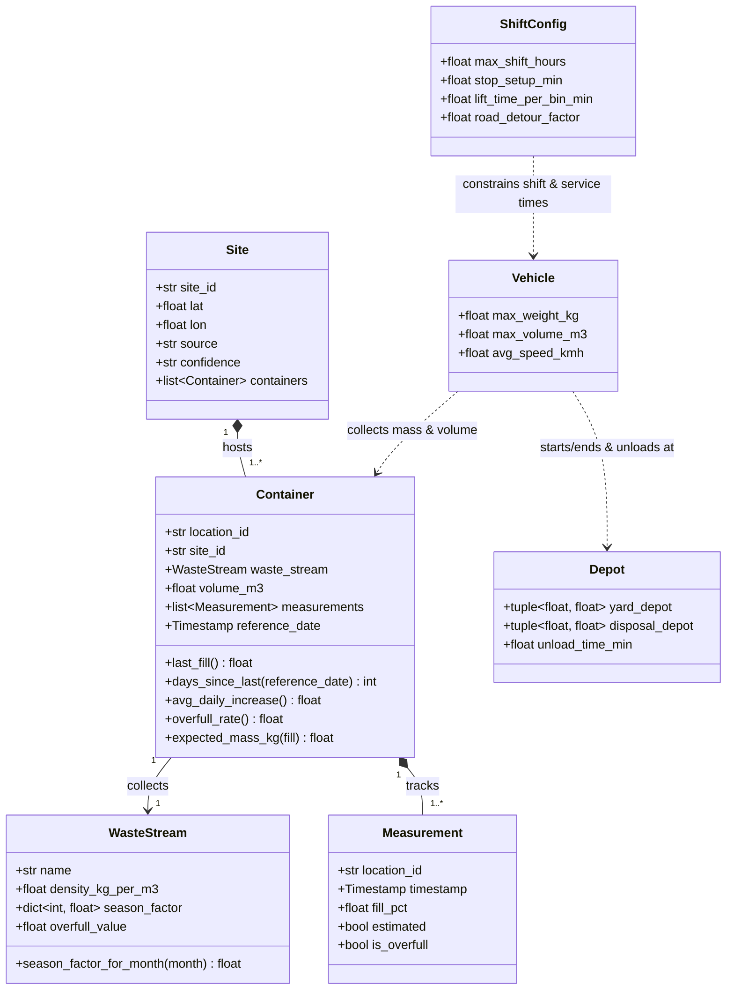

# GlasRoute – Domain Model (`src/prezero/model.py`)

Das Domänenmodell bildet die physische Sammelstruktur (Standort, Behälter, Abfallart, Messung) sowie die operativen Fahrzeug-, Depot- und Schichtparameter als reine Python-Dataclasses ab.

## Klassendiagramm

## Dokumentierte Annahmen (`# Annahme, von PreZero zu ersetzen`)

| Klasse | Attribut | Default | Bedeutung |
|---|---|---|---|
| `WasteStream` | `density_kg_per_m3` | `400.0` | Schüttdichte Altglas ($\text{kg/m}^3$) |
| `WasteStream` | `season_factor` | Jan–Apr `1.0`, Mai/Dez `0.7`, Jun–Nov `0.5` | Saisonfaktoren aus den Rohdaten |
| `WasteStream` | `overfull_value` | `110.0` | Numerischer Ersatzwert für `overfull` |
| `Container` | `volume_m3` | `2.5` | Nennvolumen je Glascontainer ($\text{m}^3$) |
| `Measurement` | `estimated` | `True` | Sichtschätzung durch Fahrer (kein Sensor) |
| `Vehicle` | `max_weight_kg` | `11000.0` | Maximale Fahrzeug-Zuladung ($\text{kg}$) |
| `Vehicle` | `max_volume_m3` | `26.0` | Maximales Ladevolumen ($\text{m}^3$) |
| `Vehicle` | `avg_speed_kmh` | `25.0` | Durchschnittsgeschwindigkeit im Stadtverkehr |
| `Depot` | `yard_depot` | `(49.1427, 9.2109)` | Koordinaten Betriebshof (Start/Schichtende) |
| `Depot` | `disposal_depot` | `(49.1780, 9.2085)` | Koordinaten Entladestelle / Verwertung |
| `Depot` | `unload_time_min` | `20.0` | Entladedauer an der Verwertungsanlage ($\text{min}$) |
| `ShiftConfig` | `max_shift_hours` | `8.0` | Maximale Schichtdauer je Fahrer ($\text{h}$) |
| `ShiftConfig` | `stop_setup_min` | `2.0` | Rüstzeit pro angefahrenem Standort ($\text{min}$) |
| `ShiftConfig` | `lift_time_per_bin_min` | `3.0` | Kranhubzeit pro geleertem Behälter ($\text{min}$) |
| `ShiftConfig` | `road_detour_factor` | `1.35` | Umwegfaktor Straße vs. Luftlinie |
