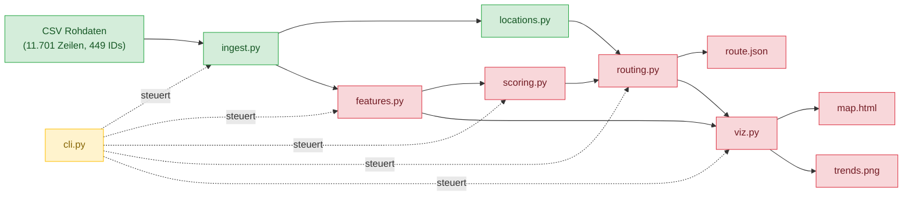
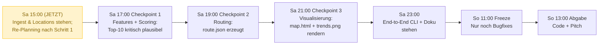

# GlasRoute (PreZero Route) – Projektstatus

**Stand:** Samstag, 14.11.2026, 15:05 Uhr · **Abgabe:** Sonntag, 15.11.2026, 13:00 Uhr

---

## 1. Was ist GlasRoute?

**GlasRoute** ist ein Prototyp für **PreZero / kommunale Entsorgungsdisponenten** in Heilbronn, der historische und aktuelle Glascontainer-Füllstände in priorisierte, vom Menschen freigegebene Abholrouten übersetzt, um Leerfahrten zu vermeiden und Überläufe zu verhindern.

---

## 2. Pipeline-Überblick

*Legende: **Grün** = fertig & getestet · **Gelb** = teilweise umgesetzt · **Rot** = Stub / fehlt*

---

## 3. Wo wir stehen

*(Testlauf: `PYTHONPATH=src pytest -v` → **18 passed**; ohne `PYTHONPATH` schlägt Collection mit `ModuleNotFoundError: prezero` fehl, da Paket nicht editable installiert ist.)*

| Modul | Status | Datei | Tests | Was noch fehlt |
|---|---|---|---|---|
| **CSV (Rohdaten)** | Fertig | `data/raw/glass_fill_levels_anonymized_f.csv` | Geprüft via `test_load_raw` & `test_full_raw_dataset_has_exactly_449_ids` | Nichts (nur bei Bedarf echte PreZero-Koordinaten) |
| **ingest** | Fertig | `src/prezero/ingest.py` (`scripts/01_ingest.py`) | 2 Tests in `tests/test_pipeline.py` (passed) | Nichts; `cleaned_readings.csv` existiert |
| **locations** | Fertig | `src/prezero/locations.py`, `scripts/fetch_locations.py`, `scripts/refresh_locations.py` | 16 Tests in `tests/test_locations.py` (passed) | Echte PreZero-Zuordnung (`locations_real.csv`); aktuell OSM-Heuristik (`low`) / Synthetik |
| **cli** | Teilweise | `src/prezero/cli.py` | Keine Tests | Subcommands `analyze`, `score`, `route`, `visualize` (nur `ingest_cmd` vorhanden) |
| **features** | Stub | `src/prezero/features.py` | Keine Tests | Komplette Implementierung (`build_features` wirft `NotImplementedError`) |
| **scoring** | Stub | `src/prezero/scoring.py` | Keine Tests | Komplette Implementierung (`score_containers` wirft `NotImplementedError`) |
| **routing** | Stub | `src/prezero/routing.py` | Keine Tests | Komplette Implementierung (`build_route` wirft `NotImplementedError`) |
| **viz** | Stub | `src/prezero/viz.py` | Keine Tests | `plot_trends` und `plot_route` werfen `NotImplementedError` |
| **Outputs** | Fehlt | — | — | `route.json`, `map.html`, `trends.png` (vorhanden ist nur `location_sanity_check.html`) |

---

## 4. Zeitplan bis zur Abgabe

---

## 5. Wohin der Plan geht (Nächste 3 Schritte)

1. **Schritt 1 abschließen & Re-Planning-Gate:** Datengrundlage/Ingest finalisieren und Prior-Art-Recherche auswerten (**Samuel**), Ortsdaten bei Bedarf pflegen (**Kimi**); direkt danach Scope-Check & Zielschärfung für Schritte 2–5.
2. **Features, Scoring & Visualisierung bauen:** `features.py`, `scoring.py` und Pandas-Auswertung/Plots in `viz.py` umsetzen und testen (**Diebsig**; Rolle von **Zed**: *unklar*).
3. **Routing, CLI & Demo-Interface umsetzen:** `routing.py` (`route.json`), fehlende CLI-Befehle in `cli.py` sowie (je nach Gate-Entscheidung) das geplante lokale Web-Frontend / RAG-Konzept für Schritt 2 aufbauen (**Samuel / Diebsig** – genaue Aufteilung nach Gate: *unklar*; Rolle von **Zed**: *unklar*).

---

## 6. Pitch-Faden

- **Problem:** Glascontainer in Heilbronn werden nach festem Plan geleert – halbleere werden angefahren, andere laufen über. → **[Echte Daten]** (11.701 Messungen, 449 Container, 1.192 `overfull`-Ereignisse in der Roh-CSV)
- **Warum lösen:** Jede unnötige Fahrt kostet Sprit, Zeit und CO₂; überfüllte Container verschmutzen die Stadt. → **[Unklar / qualitativ]** (konkrete Euro-/CO₂-Werte noch nicht berechnet)
- **Was wir sparen:** Fahrzeug fährt nur kritische Container an; Weißglas füllt sich schneller als Braun/Grün; saisonaler Peak Jan–Apr, Einbruch im Sommer. → **[Muster: Echte Daten | Einsparung in km/Zeit: Simuliert / noch offen]**
- **So funktioniert es:**
  1. Füllstände einlesen → **[Echte Daten / fertig]** (`ingest.py`)
  2. Muster erkennen → **[Noch offen]** (`features.py` Stub)
  3. Kritikalitäts-Score berechnen → **[Noch offen]** (`scoring.py` Stub)
  4. Route für ein Fahrzeug vorschlagen → **[Simuliert / noch offen]** (`routing.py` Stub + heuristische/synthetische Koordinaten)
  5. Disponenten-Freigabe (Human-Agent Interface) → **[Noch offen]**

---

## 7. Risiken & Gegenmaßnahmen

1. **Keine echten PreZero-Koordinaten** (nur heuristische OSM-Zuordnung mit `confidence=low` oder synthetische Platzhalter) → *Gegenmaßnahme:* `data/external/locations_real.csv` lässt sich jederzeit per `scripts/refresh_locations.py --real` ohne Codeänderung einspielen.
2. **Scope Creep** (z. B. variables CSV-Schema, Web-UI, lokales LLM/RAG & Voice vor funktionierendem Kern) → *Gegenmaßnahme:* Bewusstes Re-Planning-Gate nach Schritt 1, Fokus auf ein Fahrzeug und harter Feature-Freeze am Sonntag um 11:00 Uhr.
3. **Zeitdruck beim Kern-Code** (`features`, `scoring`, `routing`, `viz` sind noch Stubs) → *Gegenmaßnahme:* CLI-first-Kern bis Samstag 23:00 Uhr fertigstellen und bei Bedarf auf die dokumentierten Fallbacks (2–3 Features, Route als Liste, statische PNGs) zurückfallen.
