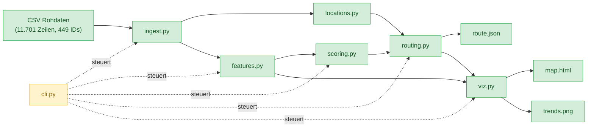
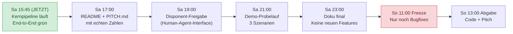

# GlasRoute (PreZero Route) – Projektstatus

**Stand:** Samstag, 14.11.2026, 15:45 Uhr · **Abgabe:** Sonntag, 15.11.2026, 13:00 Uhr

---

## 1. Was ist GlasRoute?

**GlasRoute** ist ein Prototyp für **PreZero / kommunale Entsorgungsdisponenten** in Heilbronn, der
historische und aktuelle Glascontainer-Füllstände in priorisierte, vom Menschen freigegebene Abholrouten
übersetzt, um Leerfahrten zu vermeiden und Überläufe zu verhindern.

---

## 2. Pipeline-Überblick

*Legende: **Grün** = fertig & getestet · **Gelb** = teilweise umgesetzt*

---

## 3. Wo wir stehen

**Testlauf:** `PYTHONPATH=src pytest -q` → **35 passed**.
**End-to-End:** `PYTHONPATH=src python3 -m prezero.cli run --date 2026-04-15` läuft ohne Fehler.

| Modul | Status | Datei | Tests | Was noch fehlt |
|---|---|---|---|---|
| **CSV (Rohdaten)** | Fertig | `data/raw/glass_fill_levels_anonymized_f.csv` | `test_load_raw`, `test_full_raw_dataset_has_exactly_449_ids` | Nichts |
| **ingest** | Fertig | `src/prezero/ingest.py` (`scripts/01_ingest.py`) | 2 Tests | Nichts; `cleaned_readings.csv` existiert |
| **locations** | Fertig | `src/prezero/locations.py`, `scripts/fetch_locations.py`, `scripts/refresh_locations.py` | 16 Tests | Echte PreZero-Zuordnung (`locations_real.csv`) |
| **features** | Fertig | `src/prezero/features.py` | 3 Tests | Nichts |
| **scoring** | Fertig | `src/prezero/scoring.py` | 4 Tests | Nichts |
| **routing** | Fertig | `src/prezero/routing.py` | 7 Tests | Nichts |
| **viz** | Fertig | `src/prezero/viz.py` | 3 Tests | Nichts |
| **cli** | Fertig | `src/prezero/cli.py` | — (End-to-End geprüft) | Eigene CLI-Tests (`CliRunner`) |
| **Outputs** | Fertig | `route_2026-04-15.json`, `map_2026-04-15.html`, `trends.png` | — | Nichts |

---

## 4. Zahlen für den Pitch (belegt aus der Pipeline)

Demo-Datum **15.04.2026**:

| Kennzahl | Wert |
|---|---|
| Kritische Locations | 169 (213 Material-Paare) |
| Aktive Locations gesamt | 431 |
| Geplante Route (25 Stopps) | **119,75 km** |
| Volle Runde (431 Stopps) | 157,72 km |
| **Ersparte Strecke** | **37,97 km = 24,1 %** |
| Benötigte Fahrzeuge | 2 (1 Fahrzeug = 1 Runde) |
| Schichtstunden gesamt | 8,52 h (Limit 8,0 h) |
| Sammelmenge | 41,8 t (2,5 m³/Container, 400 kg/m³) |

Weitere Muster aus den Rohdaten: Weißglas erzeugt die meisten `overfull`-Ereignisse (731 von 1.192),
saisonaler Peak Januar–April, Einbruch im Juni/Juli.

Annahmen sind vollständig in `route_2026-04-15.json` unter `assumptions` dokumentiert
(Dichte, Containervolumen, Fahrzeuglast, Umwegfaktor 1,35, Tempo 25 km/h, Umschlagzeiten).

---

## 5. Zeitplan bis zur Abgabe

---

## 6. Nächste Schritte

1. **`docs/PITCH.md` mit echten Zahlen füllen** (Abschnitt 4 dieser Datei als Quelle).
2. **Disponent-Freigabe implementieren** — der letzte offene Deliverable-Punkt: Agent schlägt Route
   vor, Mensch bestätigt, erst dann wird exportiert.
3. **README aktualisieren** — Pipeline-Kommandos und Demo-Ablauf.
4. **Pitch-Deck** (Slides) für 13:00.

---

## 7. Risiken & Gegenmaßnahmen

1. **Keine echten PreZero-Koordinaten** → 126 reale OSM-Standorte, Zuordnung bleibt
   `confidence=low`/`UNVERIFIED`; Rest sind benannte Platzhalter (Seed 2026). Austauschpfad:
   `data/external/locations_real.csv` + `scripts/refresh_locations.py --real`, ohne Codeänderung.
2. **Scope Creep** (Web-UI, lokales LLM/RAG & Voice) → bewusst zurückgestellt. Fokus: ein Fahrzeug,
   harter Feature-Freeze So 11:00.
3. **Overpass-Last** → Area-Query scheitert unter Last; BBox-Fallback liefert zuverlässig. Rohpayload
   wird gespeichert, damit der Demo-Lauf nicht vom Netz abhängt.
4. **Zeitdruck** → Kern steht vor So 11:00; Sonntagmorgen nur Pitch und Polieren.
