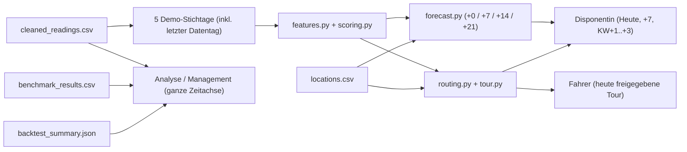

# GlasRoute UI Plan (`docs/UI_PLAN.md`)

> **Leitprinzip („Today-First“):** Einstiegspunkt der Oberfläche ist immer ein gewähltes **Stichtagsdatum** (Standard: **letzter Datentag** im Datensatz, im Demo-Lauf z. B. `30.09.2026`, bzw. das per `--date` gewählte Datum wie `15.04.2026`). Ganz oben befindet sich ein über alle Rollen und Tabs hinweg **persistenter Datums-Wähler** (`#global-date-picker`). **Jede Zahl auf der Oberfläche bezieht sich auf das gewählte Datum und benennt es explizit (`Stand 15.04.2026`).** Bei Datumswechsel werden alle Kennzahlen, Touren, 3-Wochen-Ausblicke und Exportdateien konsistent aktualisiert (im statischen Offline-Build über 5 vorberechnete Stichtage).

**Implementierung:** Selbstenthaltene Offline-HTML (`src/prezero/ui.py` → `ui_<date>.html`)
**Grundsatz:** **Ausschließlich nachweisbare Pipeline-Daten** — keine geschätzten Leerungsdaten außerhalb der Mess-/Timer-Logik, keine unbewiesenen Zahlen und strikte Trennung zwischen Tagesbetrieb und Jahresanalyse.

---

## 1. Die 3 User Stories & Ansichtsgrenzen

### Story 1: Disponentin („Ich öffne das Tool am 15.04.“) → `#role-dispatcher`
Als Disponentin öffne ich morgens das Tool für meinen gewählten Stichtag (z. B. `15.04.2026`) und sehe **sofort ohne Umwege auf einen Blick**:
1. **Welche Container sind HEUTE voll (geschätzt, +0 Tage)?**
   - Anzahl kritischer Container ($\ge 80\,\%$) und überfüllter Container ($\ge 110\,\%$) mit `Stand 15.04.2026` sowie Prioritätenliste der heute fälligen Behälter.
2. **Welche Container werden DIESE WOCHE voll (+7 Tage, KW+1)?**
   - Anzahl und Liste der Behälter, die bis `+7 Tage` (`22.04.2026`) die `80 %`-Schwelle erreichen oder überschreiten, inklusive erwarteter Zunahme gegenüber heute.
3. **Tourvorschlag für heute → prüfen, ändern, freigeben:**
   - Kompakte Touren-KPIs für heute (`Stopps`, `Strecke km`, `Fahrzeuge`, `Runden`, `Sammelmenge t`, Einsparung vs. volle Runde, `Stand 15.04.2026`).
   - Möglichkeit, eine **Tourenvariante / Änderung zu wählen** (z. B. Standard 25 Stopps, Alle kritischen Standorte, Kürzere Schicht 6 h, Kleineres Fahrzeug 8 t, Max. 20 Stopps) und die Tour explizit mit **Human-in-the-Loop Freigabe** freizugeben (`#role-approve-route-btn`).
4. **Zeitachse ausschließlich als „nächste 3 Wochen“ (`KW+1`, `KW+2`, `KW+3`):**
   - Sichtbar sind ausschließlich `Heute (+0)`, `KW+1 (+7 Tage)`, `KW+2 (+14 Tage)` und `KW+3 (+21 Tage)`.
   - **Harte Grenze:** Keine historische Zeitachse, keine Daten außerhalb `[date − 0 Tage, date + 21 Tage]`.

### Story 2: Fahrer („Ich starte meine Schicht am 15.04.“) → `#role-driver`
Als Fahrer starte ich meine Schicht am gewählten Stichtag und sehe:
1. **Ausschließlich die heute von der Disponentin freigegebene Tour**, Stopp für Stopp in **Fahrreihenfolge (nicht Score-Reihenfolge)**, inklusive `Stand 15.04.2026`.
2. **Export / Druck & Rückmeldung:**
   - Stoppliste als CSV (Fahrreihenfolge), Google-Maps-Link, Druckansicht / PDF und CSV-Export der Fahrerrückmeldung (`geleert` + vorgefundener Füllstand in `10er`-Schritten).
3. **Harte Grenze:** **Keine Historie, keine Charts**, keine Daten außerhalb `[date − 0 Tage, date + 21 Tage]`.

### Story 3: Analyse / Management („Lohnt sich das? Sind die Daten vorhersagbar?“) → `.analysis-workspace`
Als Analyst oder Management-Verantwortliche prüfe ich die Belastbarkeit und Wirtschaftlichkeit über das gesamte Jahr. **Nur hier** lebt die gesamte Zeitachse:
1. **Heatmap über alle Wochen (`#view-heatmap`):** 49 Kalenderwochen, Messwerte und geschätzte Wiederanstiege mit Klick-Sprung in die Karte.
2. **Saisonalität, Ereignisse & Verhalten (`#view-data`, `#view-datacheck`):** Monats- und Wochentrends, markierte Ereignisse (Weihnachten, Nachweihnachtsspitze, Oster-/Sommerferien, Heilbronner Weindorf), Verhaltensgruppen („Gleiches Verhalten“), Scanintervalle und Regularity Score.
3. **Fairer Vergleich (`#view-benchmark`):** B0 (Papierliste) vs. B1 (Status quo NN) vs. B2 (bedarfsgesteuert NN) vs. B3 (2-opt) vs. B4 (OR-Tools) inkl. Bedarfs- und Routing-Effekt.
4. **Vorhersagbarkeit: Forecast vs. tatsächliche Messung (`#view-data`, `#view-forecast`):** Historisches Backtesting (Timer-Modell vs. Durchschnitt bisher), Braunglas-Rhythmus und `+0/+7/+14/+21`-Prognosekarte.
5. **Konfiguration, Copilot & Upload (`#view-route`, `#view-copilot`, `#view-variables`, `#view-upload`):** Detailansicht der Route, erklärender Offline-Copilot, Annahmen/Variablen (Spec 3/4) und lokaler CSV-Datencheck.

---

## 2. Persistenter Datums-Mechanismus & Offline-Architektur

| Anforderung | Umsetzung in `src/prezero/ui.py` & `src/prezero/cli.py` |
|---|---|
| **Standarddatum** | Letzter Datentag im Datensatz (`readings_df["date"].max()`), sofern kein explizites `--date` (oder `latest`/`auto`) übergeben wird; explizites `--date` setzt den Start-Stichtag. |
| **Persistenter Datums-Wähler** | `<select id="global-date-picker">` + Rollen-Umschalter dauerhaft im `<header>` über Disponentin, Fahrer und Analyse hinweg. |
| **Konsistenter Stichtagswechsel** | `build_ui()` berechnet `4–6` Demo-Stichtage (Standard: `5`, immer inkl. Start-Stichtag und letztem Datentag) in `#date-snapshots-payload` vor. Ein Datumswechsel aktualisiert KPIs, `"Stand DD.MM.YYYY"`, `KW+1..+3`, Containerlisten, Tourenvorschläge, Stopplisten und Exporte synchron. |
| **Datums-Nachweis (`Stand DD.MM.YYYY`)** | Jede KPI-Karte und Sektionsüberschrift trägt einen dynamisch mitaktualisierten Stichtags-Hinweis (`Stand DD.MM.YYYY`). |
| **Trennung Tagesbetrieb vs. Analyse** | `#role-dispatcher` und `#role-driver` rendern strikt nur Daten im Fenster `[date − 0 Tage, date + 21 Tage]` und enthalten keine Jahrescharts oder historischen Messdaten. |

---

## 3. Data Flow (Module → Rollen & Views)

