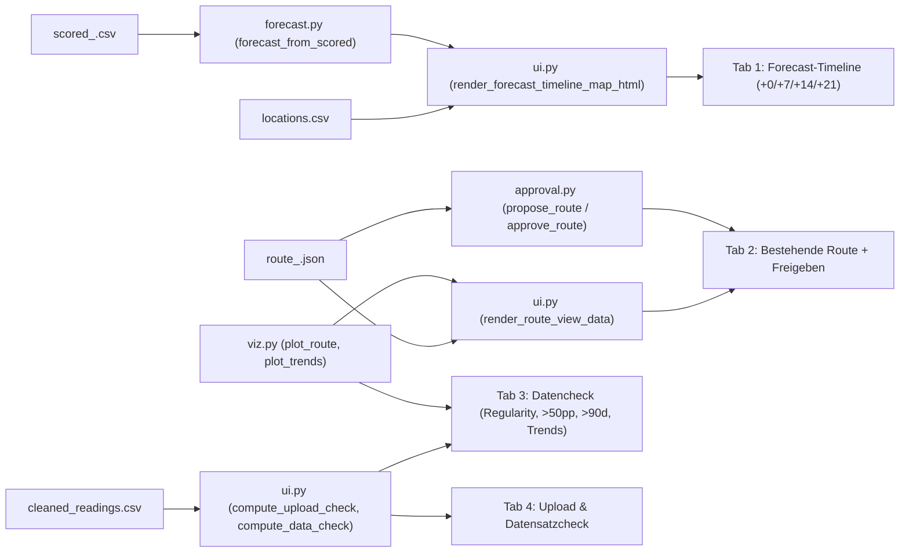

# GlasRoute UI Plan (`docs/UI_PLAN.md`)

> **User Story:** Als Fahrer möchte ich nach einer Freigabe meine heutige Tour auf dem Smartphone als große, geordnete Stoppliste sehen, je Glasfarbe den geschätzten und vorgefundenen Füllstand dokumentieren und eine CSV im Eingabeformat exportieren, damit die Rückmeldung wieder in den Forecast-Kreislauf (Scan → Schätzung → Prognose → Tour) einfließt. Als Disponentin möchte ich Tourvorschläge prüfen und freigeben; als Analyst möchte ich die bestehenden Daten-, Heatmap-, Forecast-, Fairer-Vergleich- und Copilot-Ansichten nutzen.

**Status:** Minimal, verifizierbare 4-view UI (`src/prezero/ui.py` → `ui_<date>.html`)
**Principle:** **Ausschließlich nachweisbare Pipeline-Daten** — keine Events, keine geschätzten Leerungsdaten und keine hartcodierten KPI-Zahlen ohne Datenquelle.

---

## 1. Technology Decision: Self-Contained Folium / Leaflet HTML

- **Output:** Single offline HTML file (`ui_<date>.html`) generated via `prezero-route ui --date <YYYY-MM-DD>` (`src/prezero/ui.py`, re-exported in `src/prezero/viz.py`).
- **Zero new dependencies:** Reuses `folium`, `pandas`, `matplotlib`, and the existing modules (`features.py`, `forecast.py`, `scoring.py`, `routing.py`, `approval.py`, `viz.py`).

---

## 2. The 4 UI Views (Verifiable Data Only)

### View 1 (`3. Forecast map` → Tab `1. Forecast-Timeline`)
- **Purpose:** Interactive forecast timeline across horizons (`Heute`, `+7 Tage`, `+14 Tage`, `+21 Tage`) from `forecast.forecast_from_scored()`.
- **Map Layer:** Standalone Folium/Leaflet map (**no route line** overlaid). Real/OSM sites drawn solid; synthetic placeholder sites drawn dashed and translucent.
- **Fill-Level Scale (linear, capped at `110.0%`):**
  - **Green:** `< 50%`
  - **Yellow:** `50% – 80%`
  - **Red:** `> 80%`
  - **Black:** `>= 110%`
- **Point Popup Fields (verifiable columns only):** `Location_id`, `material_type`, `last_fill_level` + `last_date`, `avg_daily_increase`, predicted fill (`forecast_pct` at `target_date`), `status`, and coordinate `source`/`confidence`. *(No emptying date, no event badges.)*

### View 2 (`4. Tour proposal` → Tab `2. Bestehende Route`)
- **Purpose:** Separate route inspection and dispatcher approval view built from `route_<date>.json` and `viz.plot_route()`.
- **Displayed Metrics (read directly from `route_<date>.json`):** `planned_km`, `full_round_km`, `saved_km`, `saved_pct`, `num_stops`, `total_critical_locations`, `total_active_locations`, `vehicles_needed`, `rounds`, `shift_hours`, `t_collected`, `comparison`, and ordered `stops`.
- **Human-in-the-Loop Action (`"Freigeben"`):** Generates and downloads `approval_<date>.json` in the exact `approval.propose_route()` / `approve_route()` schema with `EVIDENCE_FIELDS`.

### View 3 (`2. Data check` → Tab `3. Datencheck`)
- **Purpose:** Honest predictability check computed directly from `readings_df` (`compute_data_check()`).
- **Computed Metrics:**
  - Per-container `regularity_score` ($1 / (1 + \text{CV})$ of positive daily fill rates), dataset mean and median.
  - Transition counts, step jumps `> 50 pp`, series with observation gaps `> 90 days`, and `overfull` (`>= 110%`) counts.
  - Material averages, monthly averages, and embedded `trends.png` (`viz.plot_trends()`).

### View 4 (`1. Upload` → Tab `4. Upload`)
- **Purpose:** Dataset inspection summary preloaded from `cleaned_readings.csv` (`compute_upload_check()`) plus client-side `FileReader` drag-and-drop CSV validation.
- **Checks:** Total rows, unique `Location_id` count, `(Location_id, material_type)` series count, date span (`min`–`max`), measurement days, missing/invalid values, and `overfull` count.

---

## 3. Data Flow Diagram (Modules → UI Views)

---

## 4. Order of Implementation

1. **View 3 (`Forecast-Timeline`)** — first priority.
2. **View 4 (`Bestehende Route` + `Freigeben`)** — second priority.
3. **View 2 (`Datencheck`)** — third priority.
4. **View 1 (`Upload`)** — fourth priority.
