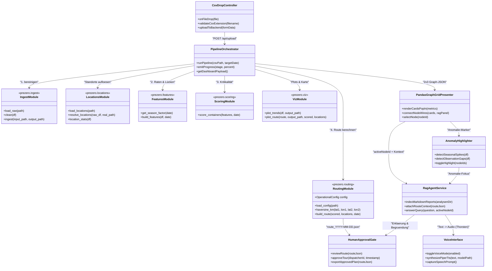
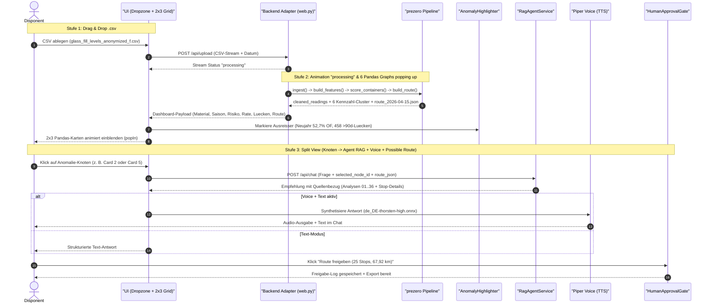
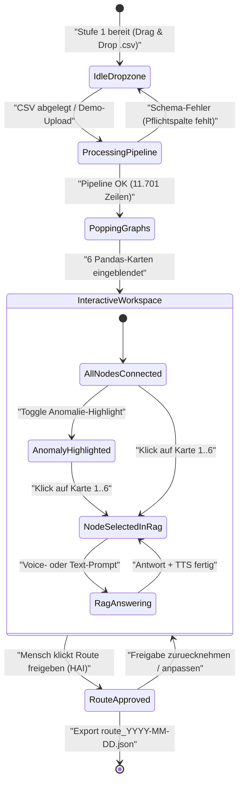

# GlasRoute — UML-Architektur (aus reMarkable-Skizze)

> **VERALTET (Stand 14.11.2026, 18:30):** Konzept-Dokument aus der Frühphase. Zahlen und Begriffe (z. B. 67,92 km / 260,82 km / −74 %, `osm_heuristic`, `synthetic_placeholder`, „338 Serien“) sind überholt. Gültig ist nur die Website `ui_2026-04-15.html` (`prezero-route run`) und `Pitch/NOTES.md`.

Dieses Dokument übersetzt die drei Stufen aus der reMarkable-Skizze (`01_remarkable_skizze_original.png`) auf das bestehende Python-Paket `src/prezero/` (`ingest.py`, `locations.py`, `features.py`, `scoring.py`, `routing.py`, `viz.py`, `cli.py`) sowie die geplanten UI-, RAG-, Voice- und Human-Approval-Komponenten.

---

## 1. UML Klassendiagramm (Komponenten & Datenfluss)

---

## 2. UML Sequenzdiagramm (Stufe ① → ② → ③)

---

## 3. UML Zustandsdiagramm (UI-Lebenszyklus)

